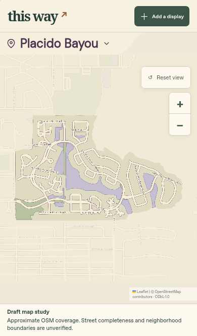

# Placido Bayou — cached-source study

**Draft only.** This is not registered in the application's picker or production
coverage. The accepted catalog remains at 87 maps.



[Landscape](landscape.png) · [Narrow phone](narrow.png) · [Zoom detail](zoom.png)

## Source and limits

The outline is the exact named OSM residential land-use feature
[`way/468834847`](https://www.openstreetmap.org/way/468834847), with its original
133-point ring. It is not a verified City or association boundary. A separate
City directory record confirms the neighborhood name; no City geometry is used.

The [source GeoJSON](source-geometry.geojson) contains only retained OSM geography
and source identities. [The recipe](recipe.json) pins two original QA file hashes,
their source paths and revision, and the merged geographic input checksum.
Repeated IDs have identical geometry across the selected inputs; no conflicting
geometry was silently chosen. Core geometry validity was checked with Shapely
2.1.2. Source tags are limited to geographic type, name, and OSM identity.

The initial Edgemoor extract does not cover the whole area. The Northeast Park
cache adds roads and water, but its complete original query coverage is not
proven. A complete source extract is still required before acceptance. The study
does not imply public access, a walking route, residence eligibility, or display
participation. There are no listings, photos, or seasonal overlays.

OSM data retains [ODbL 1.0](https://opendatacommons.org/licenses/odbl/1-0/) and
[OpenStreetMap attribution](https://www.openstreetmap.org/copyright). The preview
artwork follows the repository's [artwork terms](../../../LICENSE.md).

## Rebuild the geographic preview bundle

From the repository root, with Python 3:

```sh
python3 scripts/render-map-study.py \
  --study docs/map-studies/placido-bayou \
  --output /workspace/design-review/placido-bayou-preview-new
```

This creates a new scratch bundle with neutral SVG, map configuration, four
matched road anchors, geographic inputs, and provenance. It does not change
the application catalog. Raster generation uses the existing pinned Playwright
renderer and lossless WebP path. The screenshots use the normal app shell in an
isolated cloud preview, with an explicit draft notice outside the map canvas.

## Iteration 1: critique, revision, reflection

- Source critique: a whole named way can appear beyond an extract's query
  bounds. Its presence alone does not establish complete street coverage.
  Rechecked actual extract bounds and kept completeness explicitly unverified.
- UX critique: a generic empty-address message understated the draft's source
  limitations. Replaced it with explicit unverified-coverage wording.
- Visual critique: the overlay card covered roads in short landscape. Moved the
  study notice outside the canvas and reduced the map viewport accordingly.
- Revised review: UX and visual reviewers passed the phone, narrow, landscape,
  zoom, and picker captures as a clearly labeled draft. Four source-to-SVG road
  anchors and three viewport spacing checks passed. These do not certify source
  completeness or production readiness.
- Efficiency change for the next neighborhood: verify source identity, query
  extent and feature conflicts before drawing; reuse a dedicated draft notice
  outside the map. A public archive's matching place name is not enough—other
  searches matched Russia and Lake County, and were rejected.
- Next step: verify complete road/water coverage and the approximate area
  identity when source access works. Keep this study outside production until
  those checks pass. Greenbriar remains the separate first fresh-GIS candidate.
